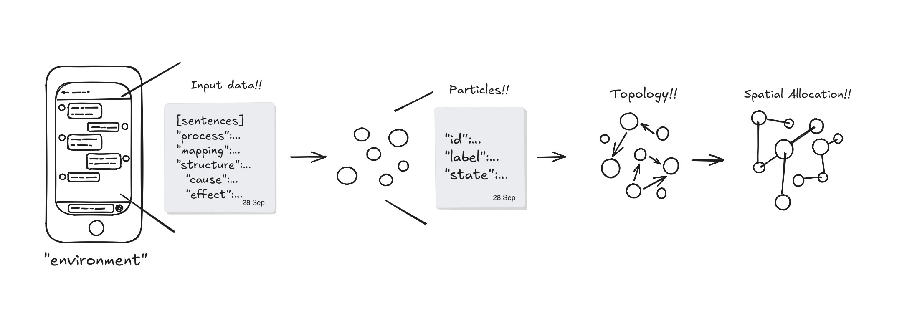

 ## CCA Architecture


1. [input-parser](https://github.com/ao-labs-123/input-parser)
2. [particle-encapsulation](https://github.com/ao-labs-123/particle-encapsulation)※Current Position
3. [topological-mapper](https://github.com/ao-labs-123/topological-mapper)
4. [spatial-allocation](https://github.com/ao-labs-123/spatial-allocation)

# Current Phase:Particle Encapsulation
**Deterministic engine that encapsulates structured context logs into algebraic particle objects.⁠**




## Stage 1 of the Cognitive OS Pipeline  
 Converts structured context logs [`log.json`](https://github.com/ao-labs-123/particle-encapsulation/blob/main/log.json) into algebraic particle objects [`particle.json`](https://github.com/ao-labs-123/particle-encapsulation/blob/main/particles.json) deterministically.

---

## Overview

This repository implements the **Particle Encapsulation** stage for the rule-based Cognitive OS. 
This module ingests the logical analysis logs generated from natural language inputs and packages them into discrete, structured **`Particle`** objects.

### Pipeline Position

```text
[ log.json ] ──> [ Particle Encapsulation ] ──> [ particles.json ] ──> (Topological Mapping)
```


## Core Data Model (⁠Particle⁠)
Each encapsulated concept or relation is structured as a **`Particle⁠`** dataclass with the following attributes:


- **id:** Unique identifier (e.g., `p_agent_f06dbc`)
- **label:** Extracted text content (e.g., `"I"`, `"you helped"`, `"i succeeded"`)
- **type:** Entity classification (`Agent`, `Cause`, `Effect`, etc.)
- **state:** Deterministic resolution state (`determined` / `unspecified`)
- **constraints:** Logical rules applied during extraction
- **properties:** Contextual properties and metadata


## Quick Start

**1. Prerequisites**

- Python 3.10+

**2. Execution**

Run the standalone entry script from the project root to ingest ⁠**`log.json⁠`** and generate **⁠`particles.json⁠`**:
```
python main.py
```

**3. Output**

The engine will parse the input log and export the encapsulated particle cloud into ⁠particles.json⁠.

```json
[
  {
    "id": "p_agent_aac8eb0fdb9c",
    "label": "He",
    "entity_type": "Agent",
    "state": "determined",
    "constraints": [
      "Explicit Subject Present"
    ],
    "properties": {
      "decision": "Priority: Explicit Subject"
    }
  },
  {
    "id": "p_event_3edbd3958741",
    "label": "succeeded",
    "entity_type": "Event",
    "state": "determined",
    "constraints": [
      "Causal Marker: because; Event: Action"
    ],
    "properties": {
      "event": {
        "category": "Action",
        "verb": "succeeded",
        "actor": "He",
        "patient": null
      }
    }
  }
]

```

## Repository Structure

```text

particle-encapsulation/
├── README.md               # Project documentation
├── log.json                # Ingested context log
├── particles.json          # Exported particle cloud output
├── main.py                 # Standalone execution script
└── src/
    ├── particle.py         # Particle data class definition
    └── factory.py          # ParticleFactory parser and transformation logic

```